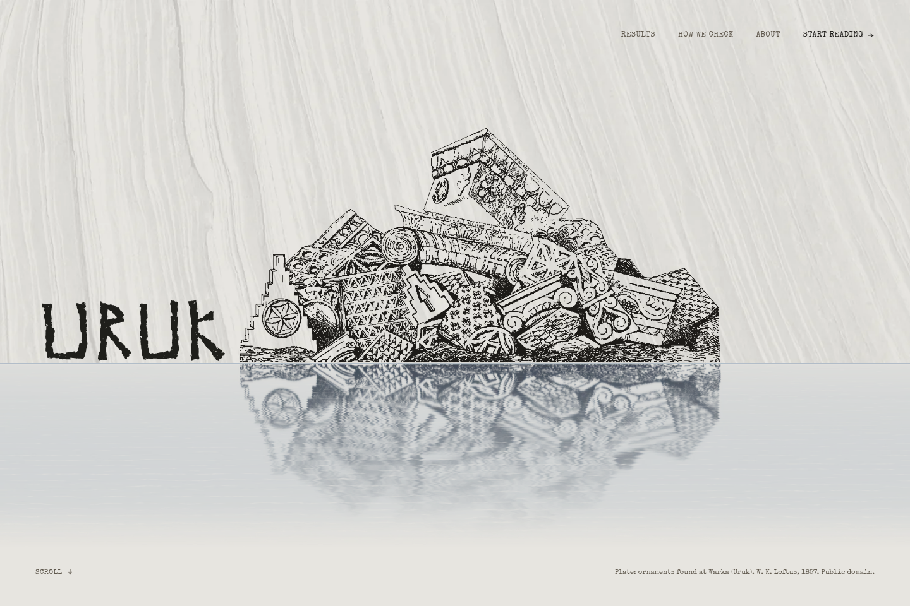
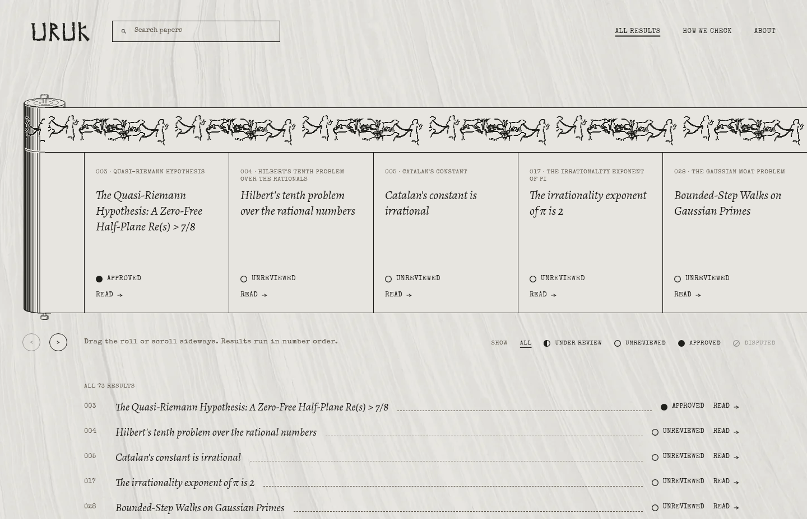
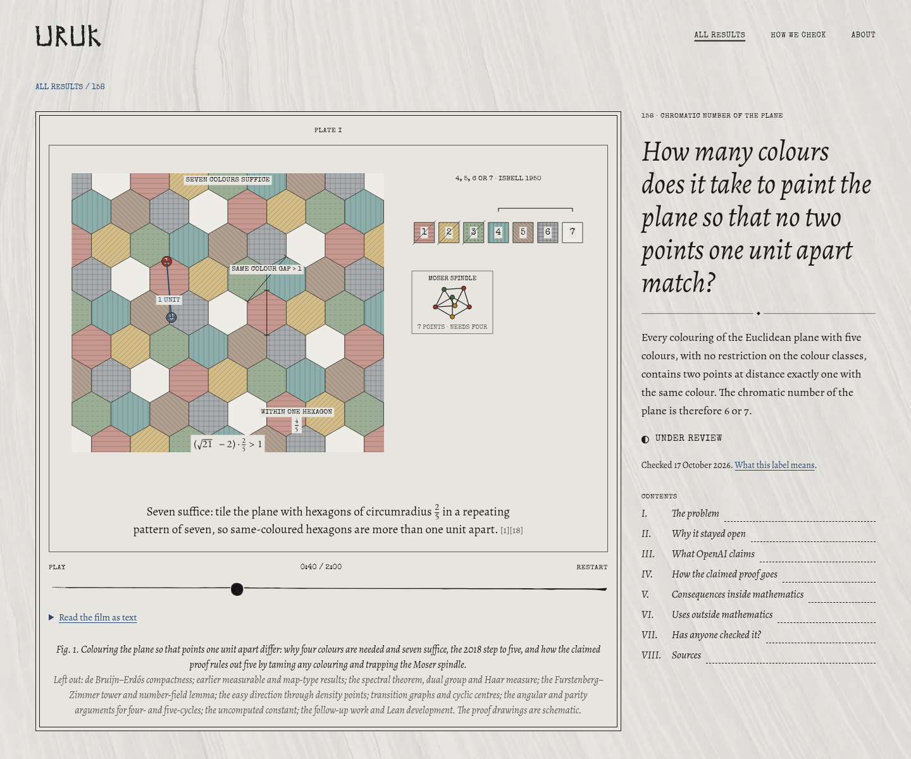
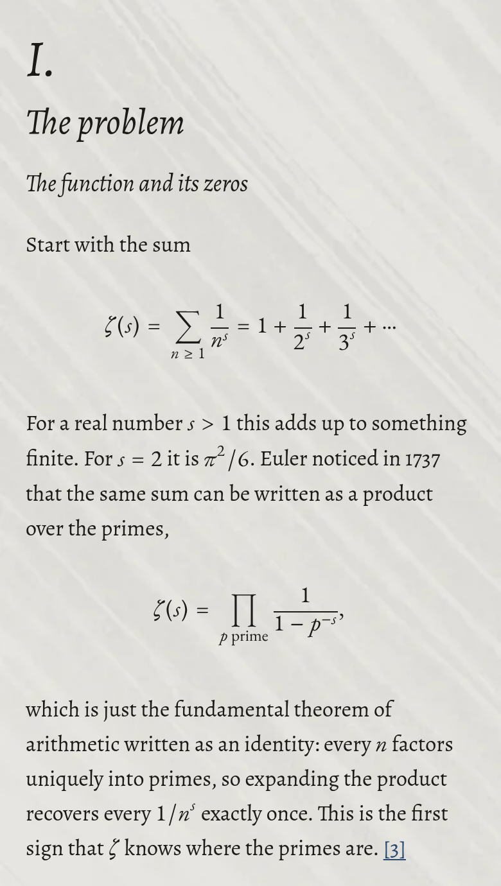

# URUK

Uruk is an open-source visual guide to selected papers from
[OpenAI's mathematics release](https://github.com/openai/math/tree/4eaee87548250b2682affda7d05d947c05554bae).
It gives readers a way into the problems without assuming a mathematics
background, with exact statements and proof maps for those who want to go deeper.

Each article explains the problem, its history, what the paper claims, how its
claimed proof works, and where the result might be useful. Numbered sources link
the explanation to the papers and supporting evidence. Dated review labels
distinguish a paper's claims from what human mathematicians have checked.

- Browse and search by paper title, topic or family number, and filter by review
  status.
- Watch interactive films on selected pages, with playback controls, a timeline,
  cue stepping, a transcript and reduced-motion support.
- Read the plain-language explanation alongside mathematical statements, proof
  maps and cited limits on applications.
- Follow links to the pinned source papers and the evidence behind each review
  label.

## Screenshots

Captured from the site on 10 November 2026.

### Home page



### Results browser



### Interactive film

Paper 158's film, paused at the seven-colour tiling of the plane.



### Reading on a phone

The start of paper 003's problem statement at a phone width.



## Run locally

Uruk uses Astro to build static pages from Markdown, TypeScript custom elements
for browser interactions, Canvas and SVG for visuals, and Temml for mathematical
notation. Bun runs the development commands and tests.

```sh
bun install
bun run dev
```

The development server uses `http://127.0.0.1:4321`. `bun run preview` serves the
latest production build on the same port. Stop one before starting the other.

## Find the code for a change

| Task | Start here | Related code |
| --- | --- | --- |
| Write or revise a result | `src/content/results/NNN-topic.md` | `src/content/schema.ts`, `sections.ts`, `render.ts` |
| Change review labels or filter keys | `src/content/review-status.ts` | `components/status-sign`, `components/menu` |
| Add or select a visual | `src/content/visuals.ts` | `components/visuals/<feature>/`, result front matter |
| Change a film's explanation or choreography | Its `story.ts` or `timeline.ts` | Its `film.ts`, drawing modules, math, and CSS |
| Change all narrated films' controls | `src/components/plate/` | `controller.ts`, `timeline.ts`, shared film components and styles |
| Change search and filtering | `src/components/menu/` | `pages/results/index.astro`, roll's public API |
| Change the results roll | `src/components/roll/` | `Roll.astro`, `element.ts`, `model.ts`, local CSS |
| Change the home-page explanation | `src/components/dig/content.ts` | `Dig.astro`, `element.ts` |
| Change the page shell | `src/layouts/` | `components/header`, `components/footer`, `src/styles` |
| Change water motion | `src/motion/water/` | `components/hero/Water.astro` |

Paths in the last column refer to `src/` or to siblings of the starting file.
The current design decisions and audit findings are in
[docs/untangle-decisions.md](docs/untangle-decisions.md).

## Work on a result

Keep the three-digit family number at the start of its filename. The schema
validates front matter; the renderer validates the required section order,
citations, source numbering, math, and review links. Collection loading and the
content command both reject duplicate family numbers or mismatched filenames.

New entries default to drafts. Development shows drafts. Production excludes them
unless `URUK_DRAFTS=1` is set. Publish by setting `draft: false` after reviewing the
article. `papers` paths refer to the pinned upstream revision in
`src/content/results.ts`.

Run `bun run check:content` while editing prose. For mathematics explanation work,
use the `uruk-paper-content` skill when available.

## Work on a visual

Each visual's directory owns its Astro entry point, mathematics, drawing,
storyboard, styles, worker, and data when needed. A new visual needs one entry in
`src/content/visuals.ts`, then a result selects its key with `visual:`. The renderer
checks every registered component path during the build.

Narrated films register through `defineFilm` in `components/plate/controller.ts`.
The feature's `element.ts` creates its drawing and connects any worker. Use the
provided abort signal to release worker resources. `createTimeline` supplies cue
lookup, settled frames, and clock formatting. Keep cue text and its settling
offset with the storyboard. Shared animation calculations live in
`src/lib/animation.ts`. `components/plate/labels.ts` owns measurement, placement,
and visibility for the films that use centered DOM labels.

The standard map, draggable unit ruler, and Thompson bands use the lower-level
player and track directly because their controls differ from narrated films.
Prime-wave number-theory code lives under `prime-waves/zeta/`. Engraving-pattern
vocabulary shared by two visuals lives in `src/lib/engraving-patterns.ts`.

## Check a change

```sh
bun run verify
```

This runs Astro and TypeScript checks, validates every result, runs the tests,
and builds production pages. There is currently no configured lint command.

For browser changes, build first, then run the interaction checks:

```sh
bun run build
bun run check:interactions
```

They exercise every published narrated film at phone and desktop widths, cue
stepping, seeking, reconnect cleanup, playback pauses, reduced motion, search,
status filters, the standard map's worker and reconnect behavior, and returning
to the top of the phone roll. They use
Chromium at `/usr/bin/chromium` and a preview server on port 4322.

For layout changes, the existing screen checker builds with drafts enabled and
checks eleven viewport configurations. Pass routes to narrow the run:

```sh
bun run check:screens / /results/ /results/003/
```

Omit routes to check every built page and the search/source variants. Screenshots
go under `/tmp/uruk-work/screens/`; the command prints the exact directory.

Keep generated `dist/`, `.astro/`, and `node_modules/` out of source edits.
Keep regression tests focused on visible behavior, mathematical invariants, or
boundary contracts. Preserve the provenance of artwork, data, and mathematical
claims.
