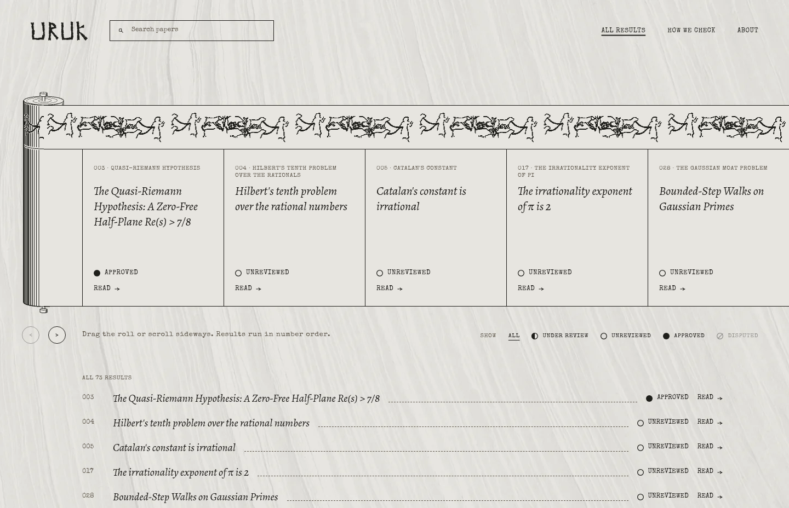
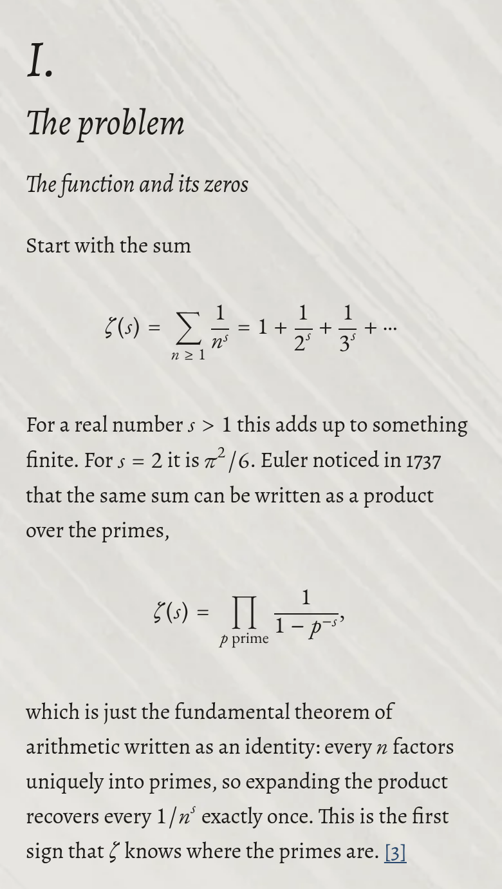

# URUK

Uruk is an open-source visual guide to selected mathematics papers produced by
AI models. The current set comes from
[OpenAI's October 2026 mathematics release](https://github.com/openai/math/tree/4eaee87548250b2682affda7d05d947c05554bae).
It gives readers a way into the problems without assuming a mathematics
background, with exact statements and proof maps for those who want to go deeper.

Each article explains the problem, its history, what the paper claims, how its
claimed proof works, and where the result might be useful. Numbered sources link
the explanation to the papers and supporting evidence. Dated review labels
distinguish a paper's claims from what human mathematicians have checked.

- Browse and search by paper title, topic or family number, and filter by review
  status.
- Watch interactive films on selected pages, with playback controls, a timeline,
  cue stepping, a transcript and reduced-motion support.
- Read the plain-language explanation alongside mathematical statements, proof
  maps and cited limits on applications.
- Follow links to the pinned source papers and the evidence behind each review
  label.

## Screenshots

Captured from the site on 10 November 2026.

### Home page


### Results browser



### Interactive film

Paper 158's film, paused at the seven-colour tiling of the plane.


### Reading on a phone

The start of paper 003's problem statement at a phone width.



## Run locally

Uruk uses Astro to build static pages from Markdown, TypeScript custom elements
for browser interactions, Canvas and SVG for visuals, and Temml for mathematical
notation. Bun runs the development commands and tests.

```sh
bun install
bun run dev
```

The development server uses `http://127.0.0.1:4321`. `bun run preview` serves the
latest production build on the same port. Stop one before starting the other.

## Find the code for a change

| Task | Start here | Related code |
| --- | --- | --- |
| Write or revise a result | `src/content/results/NNN-topic.md` | `src/content/schema.ts`, `sections.ts`, `render.ts` |
| Change review labels or filter keys | `src/content/review-status.ts` | `components/status-sign`, `components/menu` |
| Add or select a visual | `src/content/visuals.ts` | `components/visuals/<feature>/`, result front matter |
| Change a film's explanation or choreography | Its `story.ts` | Its `film.ts`, drawing modules, math, and `style.css` |
| Change every film's markup, controls or stage styles | `src/components/plate/Film.astro` | `controller.ts`, `timeline.ts`, `film.css` |
| Change how films run their workers | `src/components/plate/numerics.ts` | Each film's `element.ts` and `worker.ts` |
| Change search and filtering | `src/components/menu/` | `pages/results/index.astro`, roll's public API |
| Change the results roll | `src/components/roll/` | `Roll.astro`, `element.ts`, `model.ts`, local CSS |
| Change the home-page explanation | `src/components/dig/content.ts` | `Dig.astro`, `element.ts` |
| Change the page shell | `src/layouts/` | `components/header`, `components/footer`, `src/styles` |
| Change water motion | `src/motion/water/` | `components/hero/Water.astro` |

Paths in the last column refer to `src/` or to siblings of the starting file.
The current design decisions and audit findings are in
[docs/untangle-decisions.md](docs/untangle-decisions.md).

## Work on a result

Keep the three-digit family number at the start of its filename. The schema
validates front matter; the renderer validates the required section order,
citations, source numbering, math, and review links. Collection loading and the
content command both reject duplicate family numbers or mismatched filenames.

New entries default to drafts. Development shows drafts. Production excludes them
unless `URUK_DRAFTS=1` is set. Publish by setting `draft: false` after reviewing the
article. `papers` paths refer to the pinned upstream revision in
`src/content/results.ts`.

Run `bun run check:content` while editing prose. For mathematics explanation work,
use the `uruk-paper-content` skill when available.

## Work on a visual

A visual lives in `src/components/visuals/<key>/`. Its folder name, its catalog
key in `src/content/visuals.ts` and its element `uruk-<key>` are the same word.
A result selects it with `visual: <key>`. The renderer checks every registered
component path during the build.

A narrated film's folder holds:

| File | Holds |
| --- | --- |
| `<Name>.astro` | The film's formulas, caption, canvas description and method notes, passed to `plate/Film.astro` |
| `element.ts` | Registration with `defineFilm`, and the worker if there is one |
| `story.ts` | Cues, `TIMELINE`, and the film's timing |
| `film.ts` | The drawing: `resize(frame)` and `draw(time)` |
| `math.ts`, panels, data | The mathematics and the drawing's parts |
| `style.css` | Only what differs from the shared stage: label sizes and tones, the phone aspect ratio |
| `<key>.test.ts` | Tests of the film's mathematics, beside the code they test |

`plate/Film.astro` owns the markup every film shares: the plate, the stage and
canvas, the formula labels, subtitles, controls and transcript. `plate/film.css`
styles them. A film can add formula markup through the `labels` slot.

The controller measures the canvas, sizes its backing store and reads the
page's colour tokens. It hands the film a frame (`plate/frame.ts`): width,
height, density and tones. A film never calls `getComputedStyle` or sets
`canvas.width`. `PHONE_STAGE_WIDTH` names the width below which films use
their phone layout.

`plate/canvas/` holds drawing helpers whose bodies were identical across films:
wrapped text, fitted captions and a partial line. Add to it only code that
several films share word for word. A film's layout, choreography and drawing
style stay in the film.

A film with a worker starts it through `runNumerics` in `plate/numerics.ts`.
The helper sets `data-numerics-pending` while calculating, then
`data-numerics-ready` or `data-numerics-error` on the element,
handles a worker that cannot start, finish or transfer its data, and stops the
worker when the film disconnects.

`createTimeline` supplies cue lookup, settled frames and clock formatting. Keep
a film's timing in `story.ts` as named functions, as `pairs-rings` does; older
films still carry time literals in their drawing code. Shared animation
calculations live in `src/lib/animation.ts`. `plate/labels.ts` measures, places
and shows the centred DOM labels.

The film stage keeps its dimensions while Pressed Signs shows during startup.
Playback starts once any worker calculation finishes and the controller draws
the opening frame. If a calculation fails, the stage points readers to the
transcript. With JavaScript disabled, the article and transcript remain
available. Reduced motion holds the loader still and uses the film's settled
cue frames.

The standard map is the one interactive plate. It uses the lower-level player
and track directly because its controls differ from narrated films.
Prime-wave number-theory code lives under `prime-waves/zeta/`.

## Regenerate the cone wall artwork

Ordinary builds use the checked-in packs under `src/components/cone-wall/data/packs/`.
The press loads these LZ4 packs. The build expands them for the classic arrival
scripts, which carry raw pack bytes as base64 and rely on HTTP compression.
From the repository root, run `bun src/components/cone-wall/data/build-packs.mjs`
to regenerate them from the atlas, its head coordinates and the Special Elite font.
The generator uses the project dependencies and Chromium at `/usr/bin/chromium`.

When the Dig plates or their seams change, run
`python src/components/cone-wall/data/extract.py` first. It uses Pillow, NumPy
and OpenCV to regenerate `heads.webp` and `heads.json`. The separate
`data/decode.c` is the source for the WebAssembly LZ4 decoder embedded in
`head.js` for staged faces and labels. Changing that decoder requires Clang's
wasm32 target and a WebAssembly linker. Its compiler flags are listed at the top
of the C file.

## Check a change

```sh
bun run verify
```

This runs Astro and TypeScript checks, validates every result, runs the tests,
and builds production pages. There is currently no configured lint command.
A film's tests sit in its folder; `tests/` holds the tests that cross features.

For browser changes, build first, then run the interaction checks:

```sh
bun run build
bun run check:interactions
```

They exercise every published narrated film at phone and desktop widths, cue
stepping, seeking, reconnect cleanup, playback pauses, reduced motion, search,
status filters, the standard map's worker and reconnect behavior, and returning
to the top of the phone roll. They use
Chromium at `/usr/bin/chromium` and a preview server on port 4322.

For layout changes, the existing screen checker builds with drafts enabled and
checks thirteen viewport configurations, including two phone sizes at 3×.
Both browser check commands use temporary previews on port 4322, so run them one
at a time. The development server can stay on 4321. Pass routes to narrow the
screen check:

```sh
bun run check:screens / /results/ /results/003/
```

Omit routes to check every built page and the search/source variants. Screenshots
go under `/tmp/uruk-work/screens/`; the command prints the exact directory.

While building a film, capture stills at chosen times and widths, and report its
subtitles against the article:

```sh
URUK_DRAFTS=1 bun run build
bun run film:frames /results/166/ 0,30000,61500 1440,390,320
bun run check:subtitles 166
```

`film:frames` waits for a film's worker before the first still and saves under
`/tmp/uruk-work/frames/` unless a folder is given. `check:subtitles` lists the
subtitles that are not sentences of the article or are too long for their time.
Films built before 12 November 2026 predate both rules, so it is a report and
not part of `verify`.

Keep generated `dist/`, `.astro/`, and `node_modules/` out of source edits.
Keep regression tests focused on visible behavior, mathematical invariants, or
boundary contracts. Preserve the provenance of artwork, data, and mathematical
claims.

The core fonts in `src/assets/fonts/` retain the original outlines, spacing and
font metrics from `public/fonts/`. `styles/fonts.css` embeds the text fonts in a
shared, cached stylesheet so they arrive before text paints. Result pages also
link `styles/math-fonts.css` for the common mathematical glyphs. Keep these
stylesheets linked from `Base.astro`; importing them as ordinary CSS would
inline the font data in every production page. The original fonts supply less
common characters. Their license notices remain in `public/fonts/`.

To regenerate these assets after changing the originals, run
`python3 scripts/subset-fonts.py`. This optional asset command requires the
HarfBuzz subset library and WOFF2 command-line tools, not needed for ordinary
Bun builds. The generator records its Unicode ranges and preserves the default
HarfBuzz layout and hinting closure. The checked-in subsets were generated with
HarfBuzz 14.6.0.
