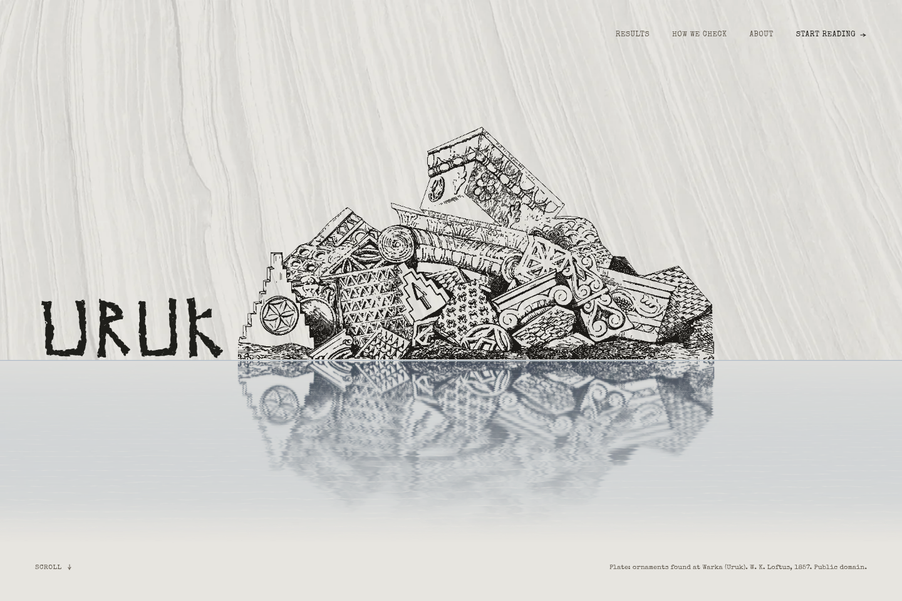
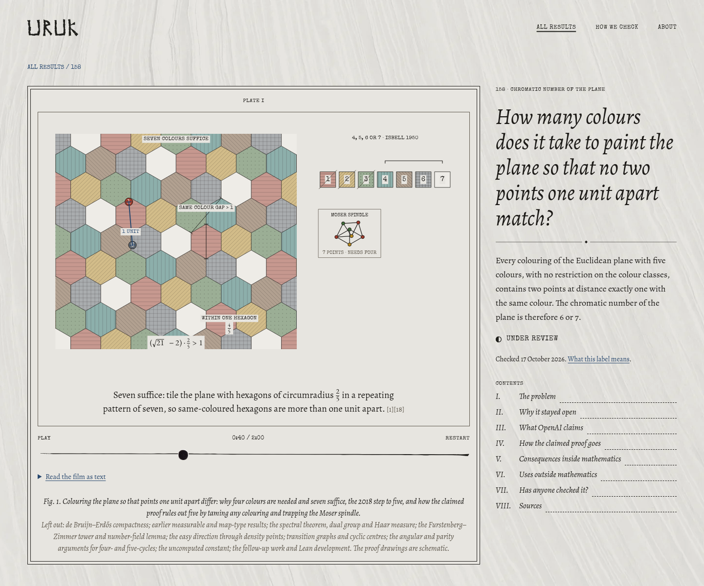

# URUK

[Visit Uruk](https://uruk-math.vercel.app/) · [Suggest a correction][correction]

Uruk is an independent, open-source visual guide to 73 mathematical results
from papers written by AI models. Each article introduces the problem in plain
language, states the claim precisely and outlines the authors' argument. The
numbered sources trace the problem's history and known applications back to
the literature. [Source papers from OpenAI's October 2026 release](https://github.com/openai/math/tree/4eaee87548250b2682affda7d05d947c05554bae).

Search by paper title, topic or result number. You can pause a film to examine
a construction, step through it one cue at a time or read the transcript. Each
article carries a dated label recording the available evidence of human review.
[Browse the results](https://uruk-math.vercel.app/results/) · [How Uruk checks claims](https://uruk-math.vercel.app/how-we-check/).

## Contribute a correction

Sign in to GitHub to suggest a correction from your browser. Include
the article URL, quote the passage and give your suggested wording. For a
mathematical correction, cite the relevant page or theorem. For a change to a
review label, link to the published review or other public evidence.
[Open a correction on GitHub][correction].

To edit an article yourself, use the three-digit number in its URL to find
the matching Markdown file. For example, `/results/158/` corresponds to
`158-plane-not-five-colorable.md`. Open the file on GitHub, click the pencil
to edit it and submit a pull request with `alpha` as the base branch.
[Article files on `alpha`](https://github.com/Aleph1-9012/URUK/tree/alpha/src/content/results).

[correction]: https://github.com/Aleph1-9012/URUK/issues/new?body=Article%20URL%3A%0A%0APassage%3A%0A%0ASuggested%20change%3A%0A%0ASource%20%28if%20applicable%29%3A

## Screenshots

Captured from the site on 10 November 2026.

### Home page



### Results browser


### Interactive film

Paper 158's film, paused at the seven-colour tiling of the plane.



### Reading on a phone

The start of paper 003's problem statement at a phone width.


## For contributors

### Run locally

Uruk uses Astro to build static pages from Markdown, TypeScript custom elements
for browser interactions, Canvas and SVG for visuals, and Temml for mathematical
notation. To preview changes locally, install Git, Bun and Node.js 22.22.0 or newer.

```sh
git clone --branch alpha https://github.com/Aleph1-9012/URUK.git
cd URUK
bun install --frozen-lockfile
bun run dev
```

Open `http://127.0.0.1:4321` in your browser. To preview the production build,
stop the development server, run `bun run build`, then run `bun run preview`
on the same port.

### Find the code for a change

| What you're changing | Where to start |
| --- | --- |
| Article text and citations | [Result files](src/content/results/), [schema](src/content/schema.ts), [renderer](src/content/render.ts) |
| Review labels and filter keys | [Review statuses](src/content/review-status.ts), [status signs](src/components/status-sign/) |
| Search and the results roll | [Menu](src/components/menu/), [roll](src/components/roll/) |
| A film or interactive figure | [Visual registry](src/content/visuals.ts), [individual visuals](src/components/visuals/) |
| Shared film controls, captions and workers | [Film components](src/components/plate/) |
| Page layout and navigation | [Layouts](src/layouts/), [header](src/components/header/), [footer](src/components/footer/) |
| Home page and water motion | [Dig section](src/components/dig/), [hero](src/components/hero/), [water animation](src/motion/water/) |

### Work on a result

Keep the three-digit result number at the start of its filename. Run
`bun run check:content` after editing. It checks the metadata, section order,
citations, source numbering, math and review links. It also flags duplicate
result numbers and mismatched filenames.

New entries default to drafts. Development shows drafts. Production excludes them
unless `URUK_DRAFTS=1` is set. Setting `draft: false` includes the article
in the production build. Paths in `papers` refer to the upstream revision in
`src/content/results.ts`.

### Check a change

```sh
bun run verify
```

This runs Astro and TypeScript checks, validates every result, runs the tests,
builds production pages and checks the generated cone wall assets. A film's
tests sit in its folder. `tests/` holds the tests that cross features.

For browser changes, run the interaction checks against a production build.

```sh
bun run build
bun run check:interactions
```

The suite checks film playback, cue navigation, reduced motion, search, review
filters and the phone roll. It also checks how the standard map reconnects to
its worker. Browser checks use Chromium at `/usr/bin/chromium`.

For layout changes, the screen checker builds with drafts enabled and
checks thirteen viewport configurations, including two phone sizes at 3×.
Both browser check commands use temporary previews on port 4322, so run them one
at a time. The development server can stay on 4321. Pass routes to check
specific pages.

```sh
bun run check:screens / /results/ /results/003/
```

Omit routes to check every built page and the search and source variants.
The command prints the directory containing the screenshots.

### Work on a visual

Each visual has a folder under `src/components/visuals/`. Register its key in
`src/content/visuals.ts` and use that key in the article's `visual` field.
For narrated films, edit `story.ts` for timing and subtitles, `film.ts` for
drawing and `style.css` for layout. Keep the mathematical calculations and
their tests alongside the film. The shared stage, controls, canvas sizing and
worker lifecycle are in `src/components/plate/`.

To inspect a film, capture stills at particular times and widths and compare
its subtitles with the article. This example captures result 166 at three
times in milliseconds and three screen widths in pixels.

```sh
URUK_DRAFTS=1 bun run build
bun run film:frames /results/166/ 0,30000,61500 1440,390,320
bun run check:subtitles 166
```

### Regenerate the cone wall artwork

Ordinary builds use the packs in `src/components/cone-wall/data/packs/`.
To regenerate them, run `bun src/components/cone-wall/data/build-packs.mjs`
from the repository root with Chromium at `/usr/bin/chromium`. If the Dig
plates or their seams change, first run
`python3 src/components/cone-wall/data/extract.py` with Pillow, NumPy and
OpenCV installed. The WebAssembly decoder source and its compiler flags are
in `src/components/cone-wall/data/decode.c`.

### Regenerate font subsets

The full fonts and their licences live in `public/fonts/`. The site loads
smaller font subsets for common text and mathematical symbols. After changing
the originals, run `python3 scripts/subset-fonts.py` to regenerate the subsets
in `src/assets/fonts/`. This command requires the HarfBuzz subset library and
WOFF2 command-line tools.

## Licences and credits

The code uses the [Apache License 2.0](LICENSE). Uruk's original article text
and review data use [CC BY 4.0](LICENSE-CONTENT.md). Artwork, typefaces and
the Uruk name and logo have separate terms. [Credits and notices](NOTICE).
